# Cartridge Club — compliance pack for PayAlly

ALDERROCK LTD · Company No. 17381132 · Dept 6984, 196 High Road, Wood Green, London, N22 8HH,
United Kingdom · https://www.cartridge-club.com/ · Billing contact: info@cartridge-club.com ·
13 October 2026

**Send this:** [`compliance-pack.pdf`](compliance-pack.pdf) — the full document with all screenshots
embedded. [`compliance-pack.html`](compliance-pack.html) is the same document in HTML,
[`order-confirmation-email.html`](order-confirmation-email.html) and [`invoice.pdf`](invoice.pdf) are
the email and invoice the customer receives.

---

## 1. Balance — top-up and spend only, no withdrawals

All references to withdrawing, cashing out or transferring Balance have been removed from the site.
Balance can only be topped up and used to pay for digital products; there is no withdrawal, payout
or transfer function in the product or in the policies.

| Page | Change |
| --- | --- |
| [/balance-terms](https://www.cartridge-club.com/balance-terms) | Rewritten. “Withdrawal of available Balance” replaced by **“No cash-out, no transfer”**. Eligibility, conversion, refunds, reversals, security, account closure and records no longer reference withdrawals. |
| [/terms](https://www.cartridge-club.com/terms) | Balance clause no longer offers withdrawal via support; carries the non-transferable-credits wording. Payment section states the statement descriptor. |
| [/privacy](https://www.cartridge-club.com/privacy) | “Balance and withdrawals” → “Balance”; no payout instructions or third-party beneficiary data are processed. |
| [/refund-policy](https://www.cartridge-club.com/refund-policy) | Credits cannot be withdrawn, cashed out or transferred; legally required reimbursement goes to the original payment method only. |
| [/pre-orders](https://www.cartridge-club.com/pre-orders), [/restricted-territories](https://www.cartridge-club.com/restricted-territories) | Remaining withdrawal references replaced. |

Shown before payment on the top-up screen, on the checkout and on the account Balance card:

> Credits are non-transferable virtual credits usable only within this platform. They are not
> cryptocurrency, not tradable, and not redeemable for cash.

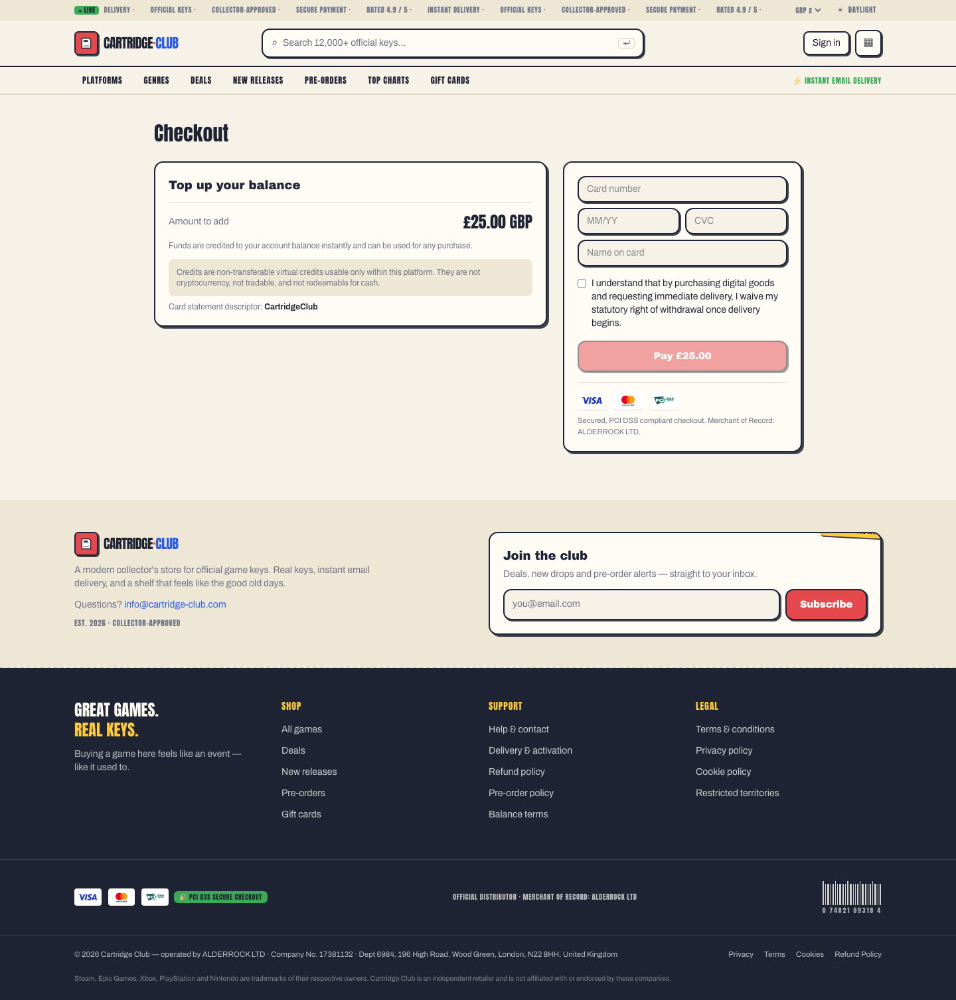

## 2. Privacy Policy — data retention

[/privacy](https://www.cartridge-club.com/privacy) now sets a maximum retention period per data
category, with automated monthly deletion and an explicit backup period.

| Data category | Retention |
| --- | --- |
| Account and profile data | 24 months after closure or last interaction |
| Orders, invoices, Balance transactions, payment records | 6 years from the end of the financial year (Companies Act 2006 s.388, HMRC); up to 10 years where an EU member state's VAT rules require it; delivered keys masked after 12 months |
| Support and complaint correspondence | 24 months after the ticket closes |
| Fraud, chargeback and dispute evidence | 6 years |
| Security, access and technical logs | 12 months; 30 days for routine logs |
| Password reset / email verification tokens | 1 hour / 24 hours, deleted on use or expiry |
| Marketing and consent records | until opt-out or 24 months without interaction; hashed suppression record kept while marketing operates; cookie consent 12 months |
| Analytics and cookie data | 13 months |
| **Backups** | encrypted, rolling **35-day** cycle, automatically overwritten; erasure propagates within 35 days |

Legal holds are covered: where erasure conflicts with a statutory obligation, an unresolved dispute
or a limitation period, processing is restricted instead of deleted and the customer is informed.

## 3. Checkout

**Card statement descriptor: CartridgeClub** — shown in the payment panel, repeated in the
Seller & billing block, stated in the Terms (Payment) and on the Balance top-up screen.

**Withdrawal waiver** — mandatory checkbox, unticked by default, enforced in the form and
server-side, shown to every customer (not only EU/UK). The same acknowledgement is required for a
Balance top-up.

> I understand that by purchasing digital goods and requesting immediate delivery, I waive my
> statutory right of withdrawal once delivery begins.

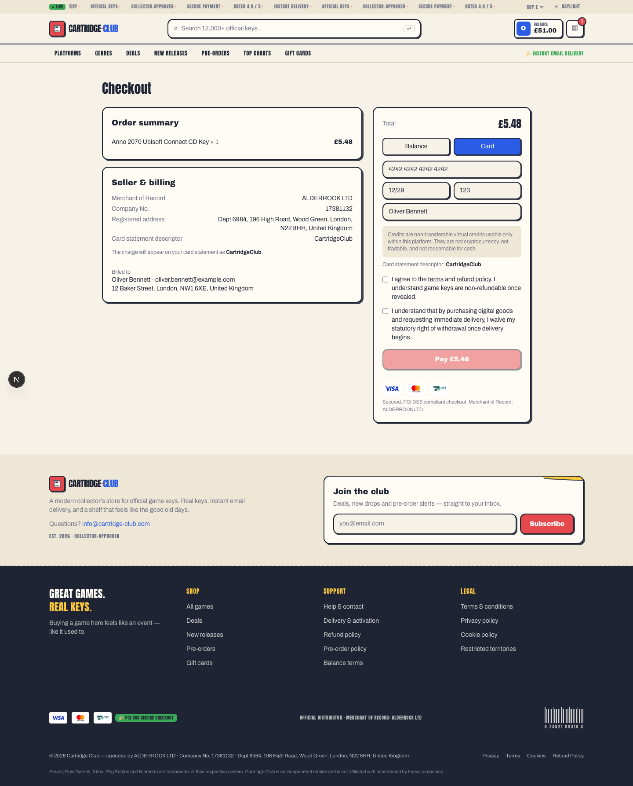

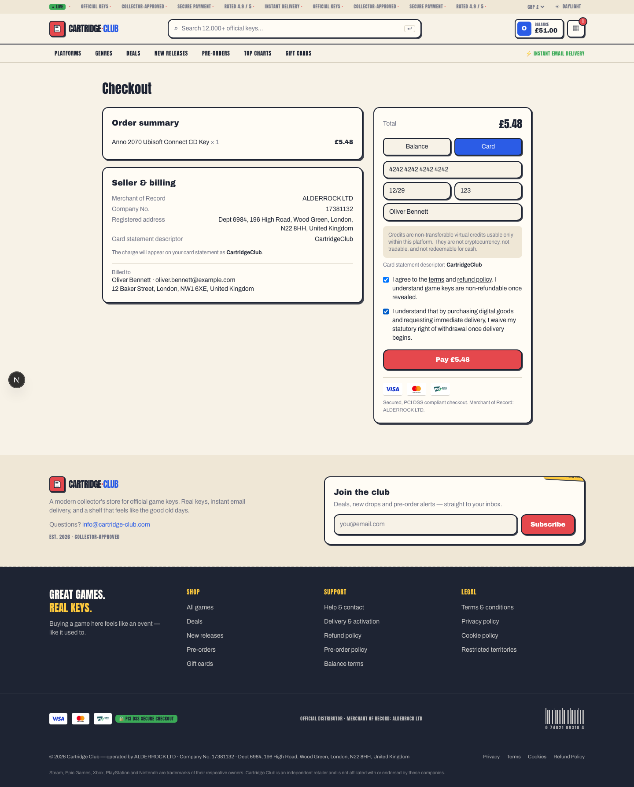

## 4. Refund Policy

[/refund-policy](https://www.cartridge-club.com/refund-policy) contains refund conditions and
exclusions, technical-failure refunds (payment captured without a key, duplicate charge, delivery
system error), acknowledgement within **2 business days** and a decision within **14 days**, a
**30-day** submission window, the chargeback procedure, the billing contact
**info@cartridge-club.com**, and a Balance section free of contradictions about cash-out.

## 5. Purchase example

The card number in the screenshots is the standard test number 4242 4242 4242 4242.

### Customer journey

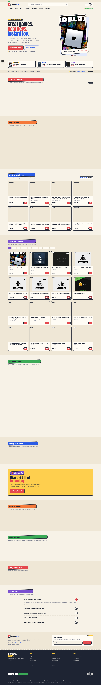
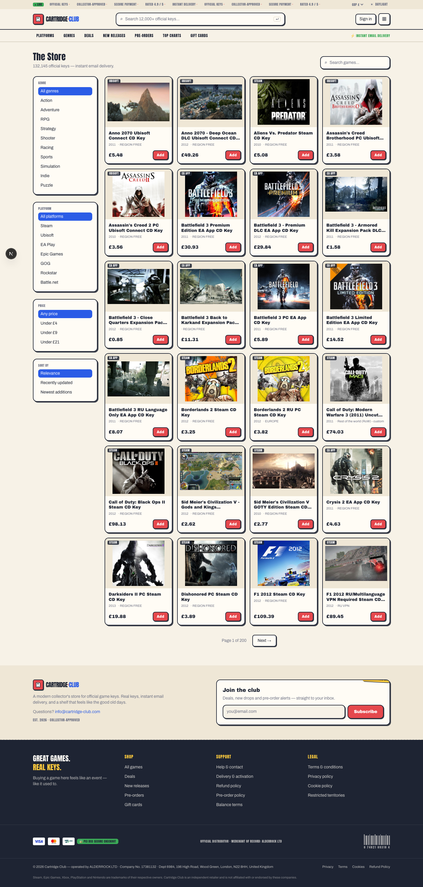
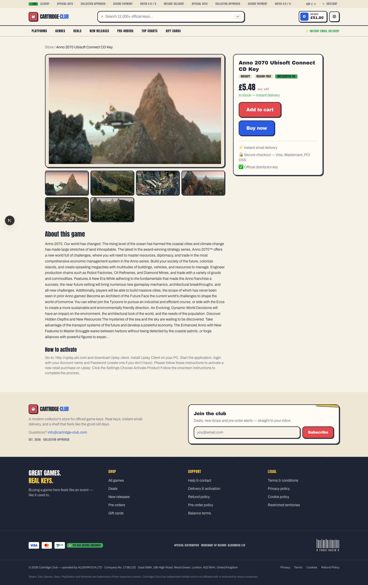
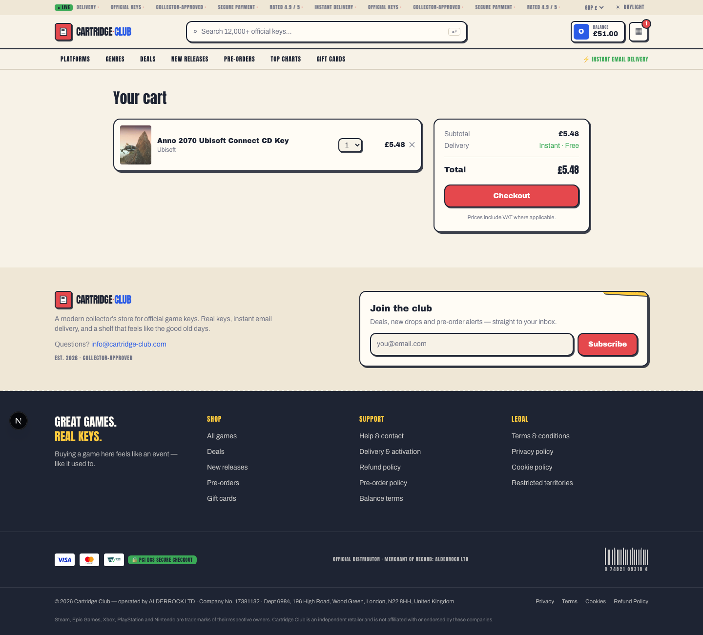
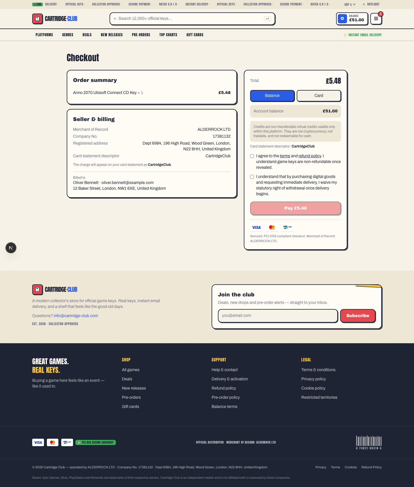

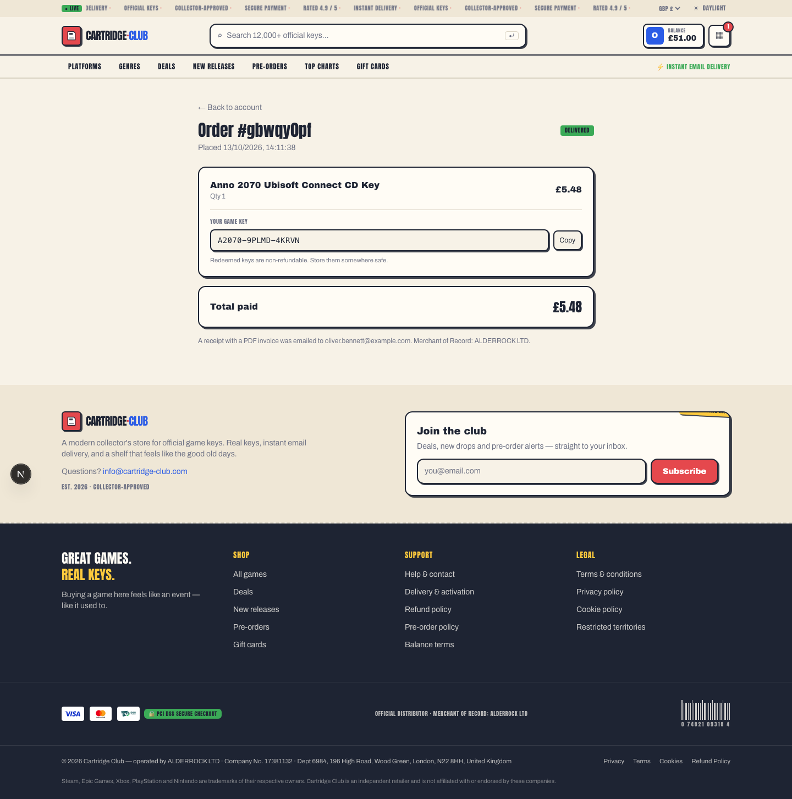
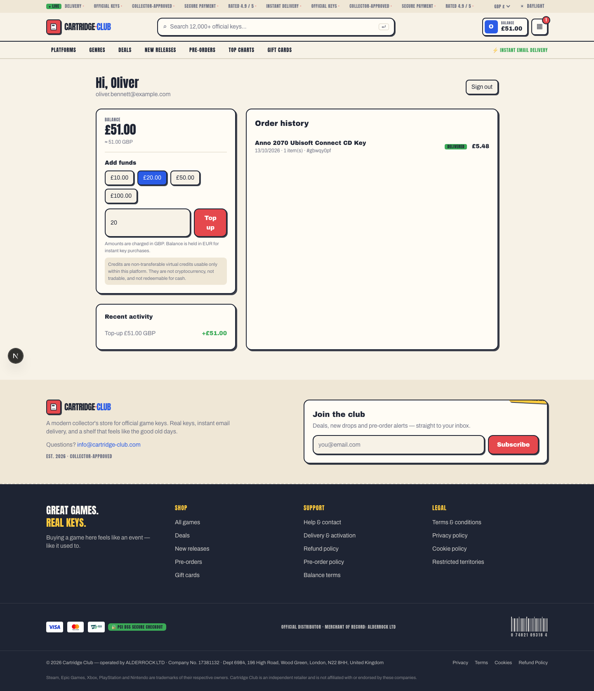

### Order in the back office

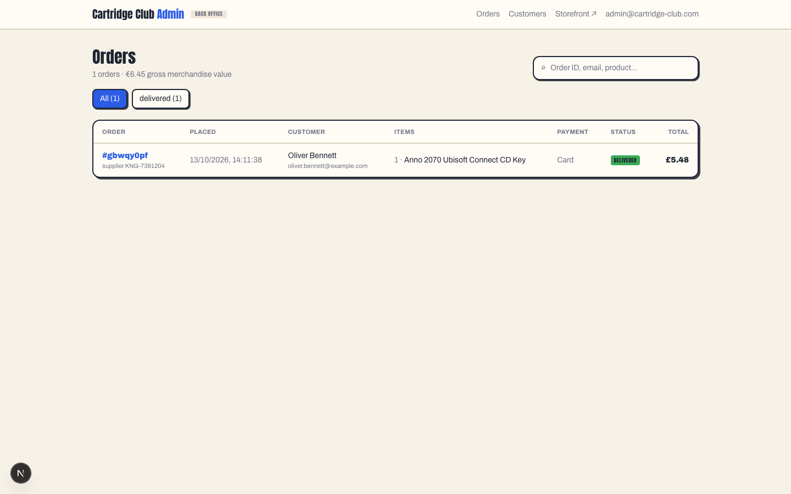
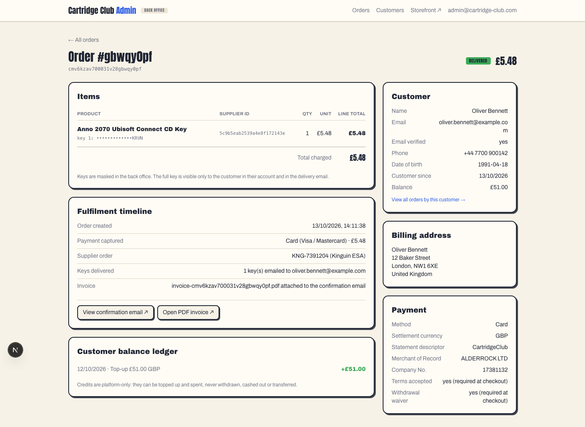
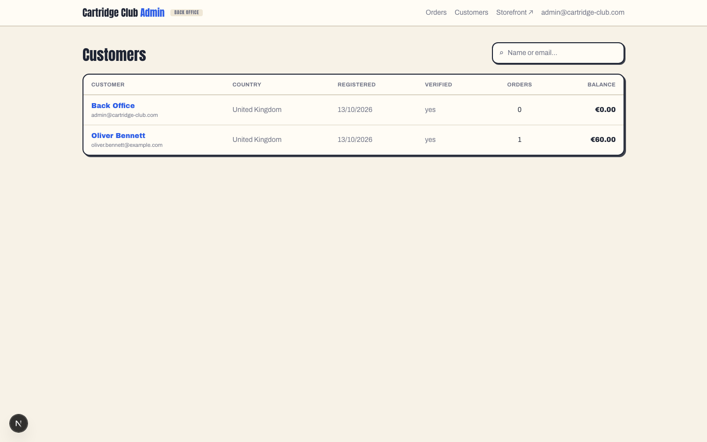

### Order Confirmation and invoice

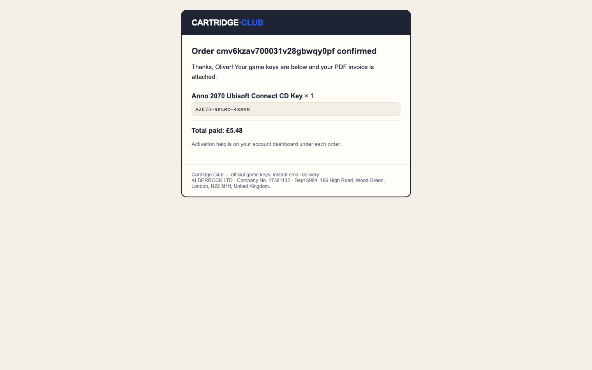

Files: [`order-confirmation-email.html`](order-confirmation-email.html) ·
[`invoice.pdf`](invoice.pdf)
